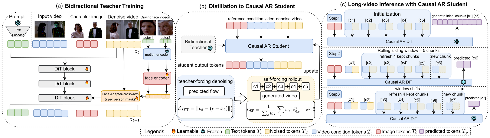

# PAI-Actor: Cinematic Multi-Character Replacement in Dynamic Scenes

**Project page:** https://showlab.github.io/PAI-Actor/  
**Model weights:** https://huggingface.co/ghyggg/PAI-Actor-release

This repository provides the **inference code** for PAI-Actor.

[▶ Teaser video](assets/teaser.mp4)



## Environment
```bash
conda env create -f environment.yml
```

## Weights
Download from [ghyggg/PAI-Actor-release](https://huggingface.co/ghyggg/PAI-Actor-release) and place both under `checkpoints/`:
- `wan2-2_channelcat_face_bg_replace_step8000.ckpt`
- `motion_encoder.pth`

## Inference
```bash
bash scripts/inference_wan2_channelcat_face.sh
```
